# PlayIDE · EIJA Studio

**Review the UML diff. Understand the change. Run the system.**

You asked an AI for a change. Now you need to understand what it did.

PlayIDE is an open-source workbench for people who read UML. It turns supported workflow edits into a visual diff you can inspect and a local application you can run. See the new path, the missing rule, the affected screen and the check that caught a mistake—before deciding what becomes active.

[](LICENSE)
[](pyproject.toml)
[](#how-close-is-it)

<!-- readme:uml-diff -->
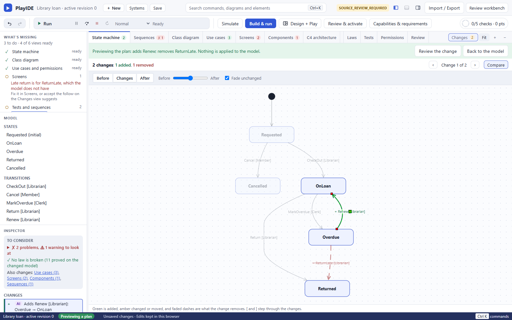

*Actual application, 11 October 2026. A supported offline proposal adds renewal and removes late returns. Both changes stay visible in the draft; the active baseline is unchanged. The proposal comes from a phrase reader, not a live model. [Capture provenance](docs/assets/readme/manifest.json).*
<!-- /readme:uml-diff -->

[Try it](#try-it) · [Features](#what-you-can-do) · [Watch a real run](#watch-a-real-run) · [Roadmap](docs/ROADMAP.md)

## Review the meaning of a change

A small code diff can change who approves a refund or remove the only way out of a workflow. PlayIDE brings those consequences into the review:

1. **Compare the UML.** See added, changed and removed states, transitions, roles and effects, with the accepted steps and their reported authorship.
2. **Follow the effects.** Move from a change to related diagrams, requirements, laws, screens and checks. Missing links and unknown effects stay visible.
3. **Check, try and decide.** Exercise the model, inspect refusals and run its generated app. The exact accepted workflow draft can enter owner review without being reinterpreted.

<!-- readme:system-effects -->
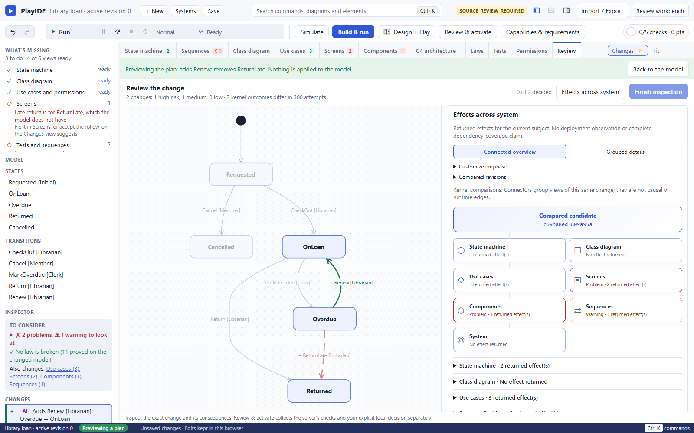

*The displayed law checks pass, and there are still two problems and a warning to investigate. Removing a path affects the screens and scenarios that depended on it. These cards group known effects of the same draft; they do not claim complete dependency coverage.*
<!-- /readme:system-effects -->

This is the practical meaning of **UML as code** here: supported model elements have executable semantics. The model drives a local web app, API and SQLite database; the same kernel decides whether an action is allowed. A diagram of an unsupported construct remains design.

**AI proposes. The kernel checks. The owner decides.** Approval and activation are separate, explicit actions. Changed implementation keeps `SOURCE_REVIEW_REQUIRED` visible until legitimate owner source review. [Read the activation contract →](docs/engineering/PLAYIDE-ACTIVATION.md)

<!-- readme:exact-app-review -->
The review names the exact workflow, data contract, screens, generated files and runtime identity. Passing checks and unknowns stay visible.

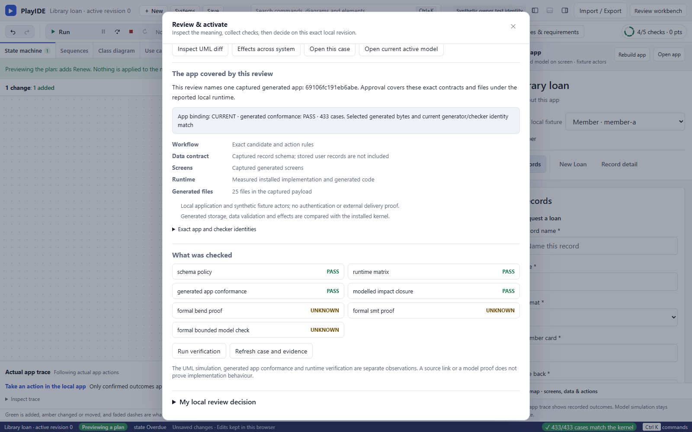

*Actual application, 12 October 2026. An explicitly labelled **synthetic owner test identity** exercises the review mechanics. This is not legitimate owner source review; the normal app still requires it. [Capture identities and scope](docs/assets/readme/react-20261012-manifest.json).*
<!-- /readme:exact-app-review -->

## What you can do

“Supported” below means the declared local workflow scope. It does not mean every UML construct or arbitrary codebase.

| Feature | What you get | Current boundary |
|---|---|---|
| **UML diff** | Added, changed and removed paths together, with the exact proposed steps | Supported typed workflow edits |
| **Diagram editing** | Edit states and transitions, inspect roles/guards, undo and redo | Server-checked edits; unsupported meaning is refused |
| **Effects across the system** | Connected or grouped views of affected models, screens, laws, requirements and tests | Known and declared relationships; unknowns remain visible |
| **Build & run** | A bundled React app with Mantine controls, HTTP API and SQLite records | One supported record class; fixture actors; no Node/CDN required to run |
| **Standard app navigation** | Model-derived Records, New record, record details and workflow actions | Create/read and supported state changes; general edit/delete need their own semantics |
| **Screen-to-model map** | Follow a React control to its record attribute, screen and workflow action | UWE-inspired checked design; the service supplies actual authority |
| **Design + Play** | Keep the model beside the running application | Shared generated-app templates and resizable layout |
| **Live action traces** | See committed actions move through the diagram; pause, inspect and replay | Scoped local observations; replay does not repeat actions |
| **C4 architecture** | Inspect system context, browser/server/database containers and components | Generated structure; not deployment or external-service proof |
| **Laws, scenarios and refusals** | Check supported policies and run actor/action sequences through the kernel | Each check has its own scope; no universal correctness claim |
| **Exact draft and app review** | Retain accepted commands, authorship, candidate, exact generated bundle and checker configuration | Workflow-only activation under unchanged pack identity; historical unbound cases remain workflow-only |
| **Domain language and source** | Inspect DDD terms, declared links and read-only repository references | Structure and explicit bindings; no general source rewriting |
| **Screens and roles** | Arrange supported forms, inspect actor permissions and run selected accessibility checks | Fixture identities; bounded checks, not full accessibility certification |
| **UML import/export** | Bring models from supported PlantUML, XMI, Mermaid and draw.io forms | Import reports what it could not carry |
| **Templates and chat** | Start from one of eleven bundled systems, including five [sector packs](docs/sector-packs.md) (healthcare referral, card payment, parcel delivery, SaaS subscription, building permit), or request supported typed changes | Current PlayIDE chat is an offline phrase reader; general live creation is unfinished |
| **Relationships and connected workflows** | Draw related classes and several workflows; inspect disagreements | Related records and cross-workflow delivery are not implemented |
| **Data-driven decisions and migrations** | Next: action inputs, value conditions, record updates and safe evolution | Planned; a stored amount does not yet decide refund eligibility |

[Explore every view](docs/playide.md) · [Generated-app scope](docs/build-an-app.md) · [Lifecycle roadmap](docs/ROADMAP.md)

## Build something you can play with

Start with **Library loan**. A supported model gives you Records, New record, record details and workflow actions, with React forms built from the declared fields. You get a usable starting app alongside the model that explains it.

<!-- readme:react-navigation -->
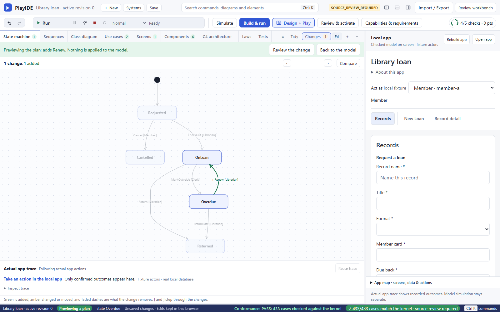

*Actual application, 12 October 2026. A local candidate build with fixture actors; the workflow has not been activated. Create/read and supported state changes work here; general record editing and deletion remain unsupported.*
<!-- /readme:react-navigation -->

<!-- readme:screen-to-model -->
**Follow a screen back to its meaning.** The app map connects a screen to its fields, declared authority, use case and record class. Its identity matches the generated app you are running; the service checks whether an action is allowed.

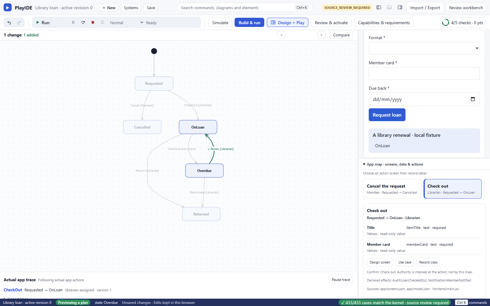

*UWE-inspired checked design, captured from the real app on 12 October 2026. This is a scoped screen-to-model map, not full UWE conformance. [Screenshot identities and scope](docs/assets/readme/react-20261012-manifest.json).*
<!-- /readme:screen-to-model -->

Try **Refund desk** for a different system. A support-agent fixture assesses a request and proposes a refund. A supervisor approves it. A payment-system fixture records settlement—or fails, leaving a recovery path to inspect.

Switch actors, try an action and see why it commits or refuses. Change the model and inspect the difference. These are useful building blocks for business systems, multiplayer communities and approval workflows.

<!-- readme:design-and-play -->
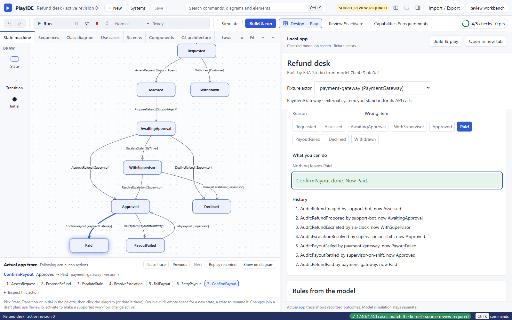

*Design + Play, 11 October 2026. Seven actions have committed to the local application. The diagram and record history agree on the outcome: Paid.*
<!-- /readme:design-and-play -->

Fixture actors are selected manually. RefundDesk moves no money, and notifications enter a local outbox rather than being delivered. Those limits matter when deciding what you can build with it today.

<!-- readme:live-trace -->
**Follow execution:** the runtime bridge links committed local app actions to the diagram. Pause to inspect recorded outcomes and replay the observation without writing to the database again. Model simulation remains a separate view.

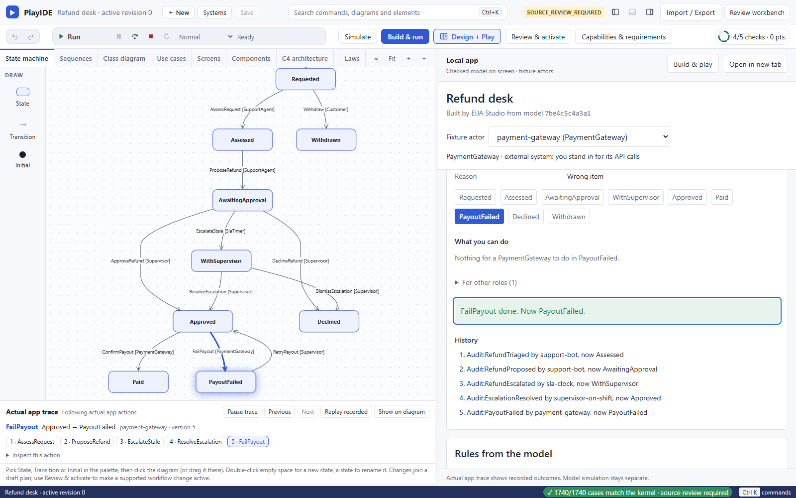

*A manually operated payment fixture records a failed payout. The action commits successfully; the business outcome is PayoutFailed. The trace identifies that same action and record version, ready to inspect and recover.*
<!-- /readme:live-trace -->

<!-- readme:c4 -->
**Zoom out to architecture:** C4 explains the generated application's context, containers and components. Browser, Python server and SQLite are structural projections of the build; an external-system role does not imply a working connector.

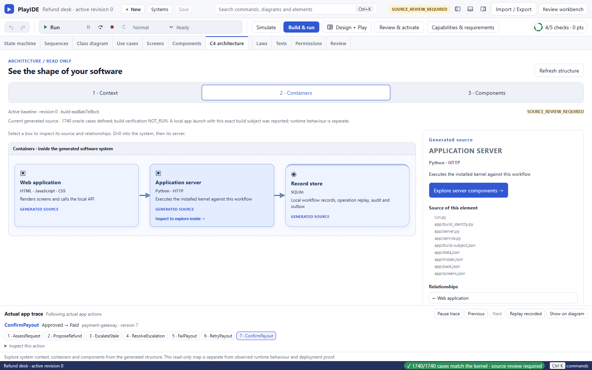

*The same generated build, viewed as C4 containers. Select a container to inspect its source or drill into components. This is generated structure; runtime observations and deployment evidence remain separate. [Screenshot identities and scope](docs/assets/readme/manifest.json).*
<!-- /readme:c4 -->

## How PlayIDE and EIJA connect

**PlayIDE is the visual workbench. EIJA is the Python engine underneath it.** The repository, the `eija-studio` package and the `eija` command keep the EIJA name. The workbench sends typed edits to the Studio API; EIJA checks the supported model and derives its diff, views and review packet. Building generates a separate React application. Its model-driven frontend sends actions to its own API, which calls the same EIJA runtime kernel. The app's navigation, components and emitted bytes participate in its exact review identity.

This is the logical flow, not a claim that every box is an independent service:

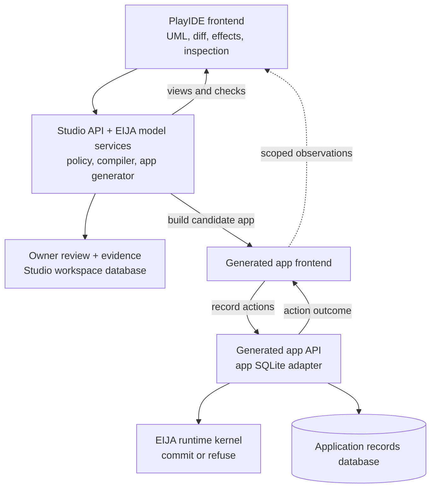

The two frontends display and request behaviour; the server decides what is allowed. A preview build does not activate the reviewed workflow. C4 describes generated structure, and connected repository source remains read-only. [Follow an edit and a runtime action through the architecture →](docs/architecture/PLAYIDE-EIJA-FLOW.md)

## Why “Play”?

The inspiration is the pleasure of building a working place in **Cities: Skylines**, growing a system in **tycoon games and Roblox tycoons**, or making something useful block by block in **Minecraft**. Place something, see what happens, understand the consequence, improve it.

Vibe coding makes it easy to produce software faster than you understand it. We call the understanding you still owe it **comprehension debt**. PlayIDE's ambition is to make gaining that understanding part of the fun: visible execution, useful failures, experimentation and the satisfaction of a checked improvement becoming real.

We want engineering to be something you want to come back to. Enjoyment and better comprehension still need testing with people; the working software and its limits come first.

## Watch a real run

**Recorded 12 October 2026 from the actual local application.**

| React app and connected map · 1:05 | Exact app review and restart · 2:28 |
|---|---|
| [](docs/demos/assets/playide-react-20261012/playide-react-navigation.mp4) | [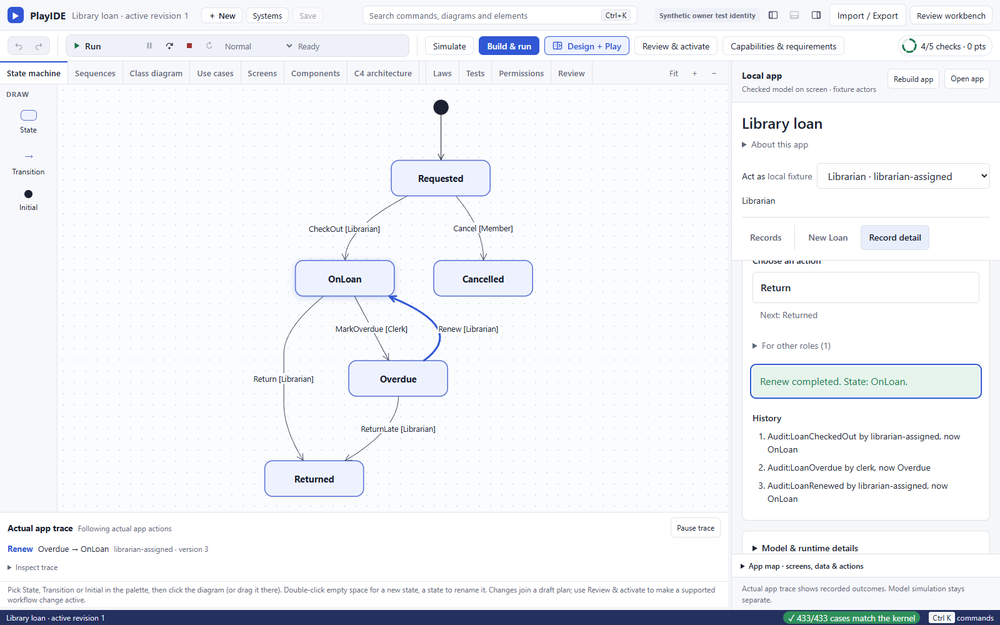](docs/demos/assets/playide-react-20261012/playide-exact-app-activation.mp4) |
| Recover from a refused model change, run a real checkout and follow connected design views. No approval or activation. | An **explicitly labelled synthetic owner** reviews and activates the exact app; a new server process reopens it and completes three real local actions. |

Fixture actors, local records and inspected recordings. The normal source-review gate remains enforced; the longer clip does not establish legitimate owner review. [Checks, exact identities and limitations](docs/demos/assets/playide-react-20261012/manifest.json) · [Post-restart native frame](docs/assets/readme/renewal-after-restart-20261012.png).

<details>
<summary>Earlier recording: RefundDesk recovery and C4 · 1:03 · 11 October 2026</summary>

Follow seven committed RefundDesk actions through the diagram, inspect a payout failure and recovery, replay without database writes, then explore C4 for that same build. This retained recording predates the React navigation and exact generated-app review shown above.

<a href="docs/demos/assets/playide-live-20261011/playide-live-c4.mp4">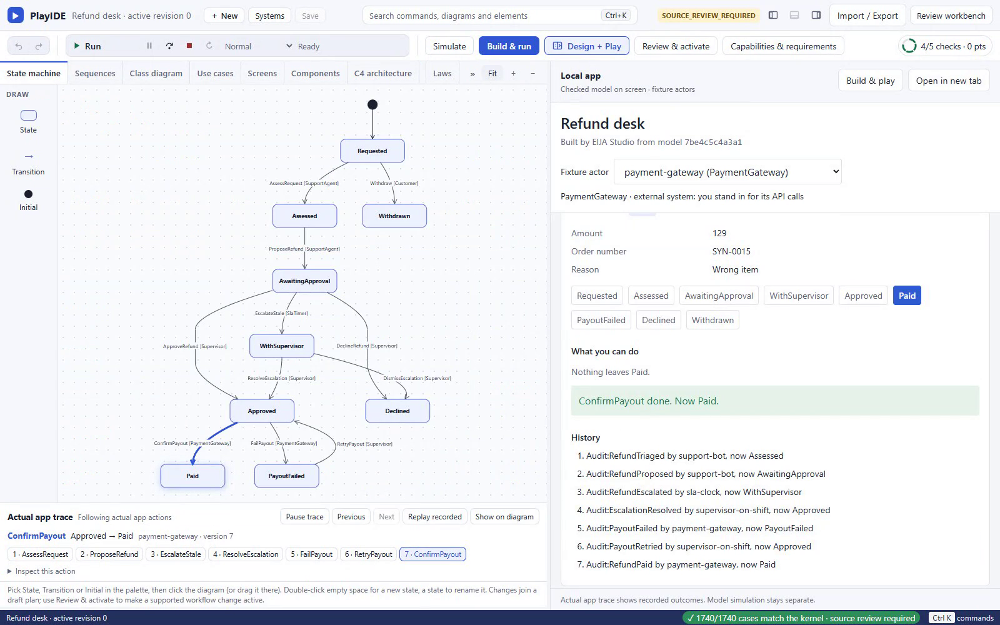</a>

Actual local application, manually operated fixture actors, no external payout. The inspected recording retains the source-review boundary. [Watch the MP4](docs/demos/assets/playide-live-20261011/playide-live-c4.mp4) · [Checks, source identity and limits](docs/demos/assets/playide-live-20261011/manifest.json).

</details>

## Try it

Python 3.11+ and Git. No Node or frontend build required.

**macOS / Linux shell**

```bash
git clone https://github.com/45ck/eija-studio.git
cd eija-studio
python3 -m venv .venv
source .venv/bin/activate
python -m pip install -e ".[dev]"
eija serve --pack packs/library-loan --open
```

<details>
<summary>Windows PowerShell</summary>

```powershell
git clone https://github.com/45ck/eija-studio.git
cd eija-studio
py -3 -m venv .venv
.\.venv\Scripts\python.exe -m pip install -e ".[dev]"
.\.venv\Scripts\eija.exe serve --pack packs/library-loan --open
```

</details>

Open the private **PlayIDE** link printed by the server. Its `/play#…` fragment is a session key; keep that link private.

Try `add Renew from Overdue to OnLoan for Librarian`, inspect the change, then **Build & run**. Or open **Systems › New system** and choose a template, or open another bundled system directly, for example `eija serve --pack packs/card-payment --open`. The [sector packs guide](docs/sector-packs.md) lists each one, the change its chat plans and the unsafe change its laws refuse. **Simulate** exercises the model; the running app commits local records.

The default setup uses loopback, SQLite and no telemetry. Live provider calls require explicit network enablement and consent. [Getting started](docs/getting-started.md) covers setup and provider options.

## How close is it?

**A working local preview, with a much larger goal.** We want someone who understands UML to design, run, debug and maintain supported software without needing to read its implementation.

The current focus is PlayIDE's own change workflow:

**Edit → UML diff → effects → check → explicit owner approval → activate → reopen.**

Exact workflow and generated-app review are implemented. A fresh-process browser test completes this journey with an explicitly labelled synthetic owner, then uses the changed React app. It checks refusals, atomic activation, duplicate safety and exact identity after restart. Legitimate owner source review and full integrated acceptance remain open. [Current evidence and limitations](docs/engineering/2026-10-11-EXACT-APP-ACCEPTANCE.md).

General live AI creation, value-driven actions, migrations, connected delivery and production identity remain unfinished. Law, vocabulary, data-schema, screen and scenario edits do not silently become active policy.

We ship small, checked commits directly to `main` throughout this initial stage. Automatic checks on push are not configured; supplied GitHub workflows are manual-only. See the [roadmap](docs/ROADMAP.md), [delivery contract](docs/engineering/PLAYIDE-DELIVERY.md) and [current acceptance criteria](docs/engineering/SELF-DOGFOOD-ACCEPTANCE.md).

## Watch the product tours

These retained recordings show the actual application **before the newer exact-draft activation, Design + Play, live-trace and C4 work**. Their chat uses the labelled offline phrase reader. They are earlier demonstrations, not current release acceptance.

| Highlights · 3:50 | Start from a sentence · 4:52 | Full tour · 13:52 |
|---|---|---|
| [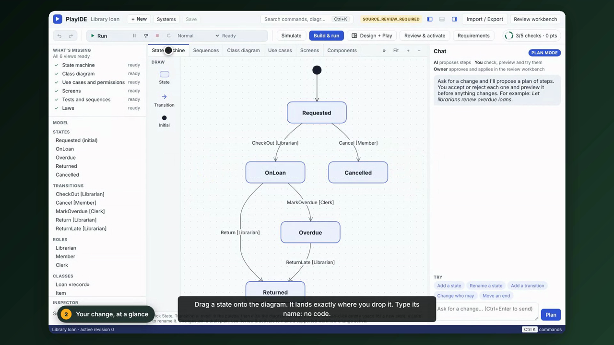](docs/demos/assets/playide-showcase/playide-highlights.mp4) | [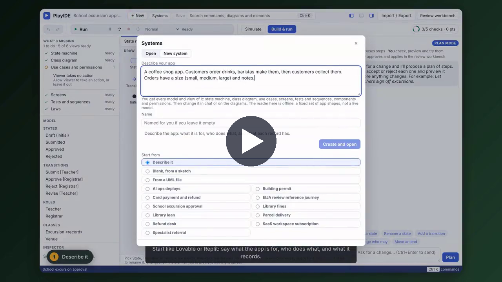](docs/demos/assets/playide-showcase/playide-greenfield.mp4) | [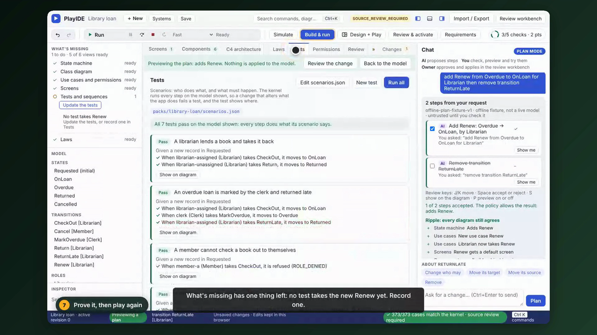](docs/demos/assets/playide-showcase/playide-showcase.mp4) |
| Review changes, discover a broken scenario and inspect a refusal. | A fixed-shape offline request produces a model you can inspect and edit. | Explore diagrams, permissions, templates and UML interchange. |

Recording steps and scope: [showcase storyboard](docs/demos/PLAYIDE-SHOWCASE-STORYBOARD.md), [greenfield storyboard](docs/demos/PLAYIDE-GREENFIELD-STORYBOARD.md).

## A diff you can reproduce

The screenshot at the top shows the workbench's review. This CLI example is another view of the same principle: derive the difference from two executable models. The excursion example adds a recommendation step while keeping final approval with the Registrar.

<details>
<summary>Open the generated UML diff, before/after models and impact details</summary>

<!-- BEGIN GENERATED: excursion-diff (scripts/gen_readme_diagram.py; do not edit by hand) -->
**Diff** (`eija render --workflow examples/excursion-candidate.json --view diff --format mermaid`): green is added, amber is changed, a `+` label is a new or changed transition and a `-` label is a transition the candidate no longer has. The first two comment lines carry the semantic hashes of the two workflows the diagram was generated from.

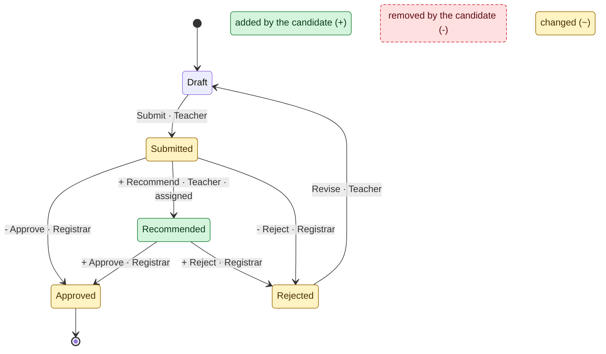

<details><summary>The same two workflows as separate state diagrams (<code>--view state</code>, baseline then candidate)</summary>

Baseline:

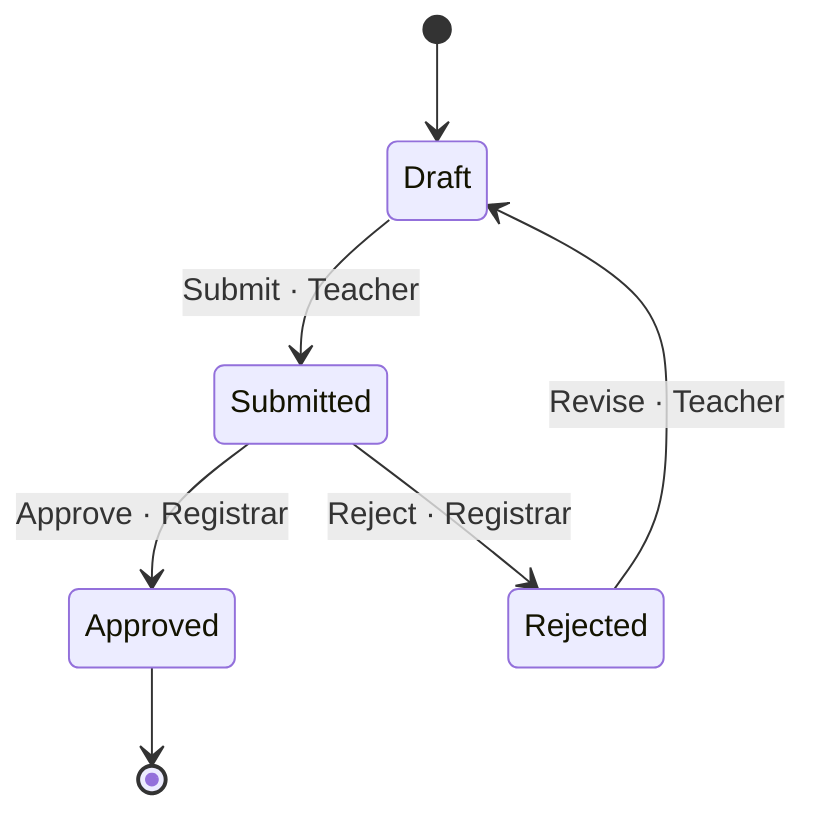

Candidate (`recommend_only`):

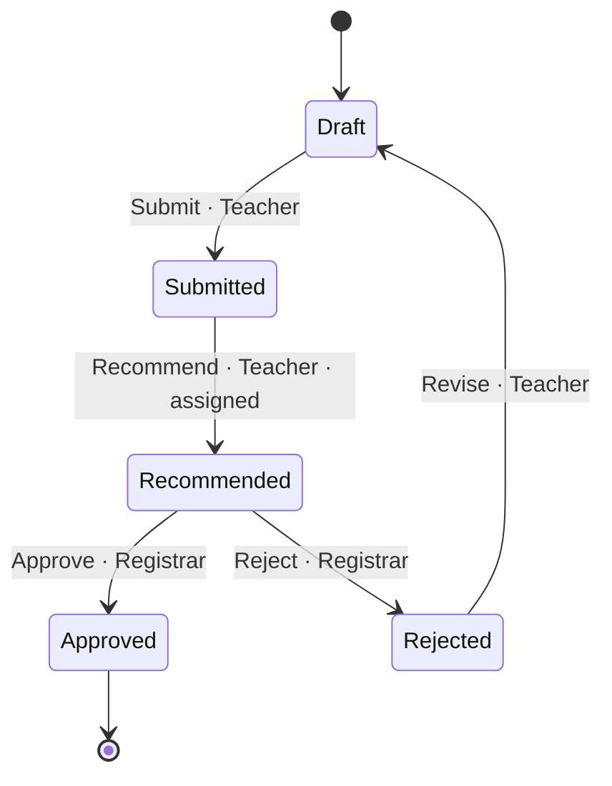

</details>

What changed, from `diff_summary` over the two typed models (not written by hand):

- new state `Recommended`
- new action `Recommend`
- `Approve` from_state: `Submitted` becomes `Recommended`
- `Reject` from_state: `Submitted` becomes `Recommended`

The kernel's own impact closure, `domain.impact.model_impact(baseline, candidate)`, reaches 20 artefacts from the changed actions `Approve`, `Recommend`, `Reject` (`complete: True`). It follows a fixed rule, runtime, state view, journey, obligation, receipt, review packet, local decision chain per action, so it is the encoded projection mapping, not every real-world consequence. Draw it with `--view impact`; the affected artefacts are:

- `journey:` Approve, Recommend, Reject
- `local-decision`
- `obligation:` Approve, Recommend, Reject
- `receipt:` Approve, Recommend, Reject
- `review-packet`
- `rule:` Approve, Recommend, Reject
- `runtime:` Approve, Recommend, Reject
- `state-view:` Approve, Recommend, Reject

`check_policy(baseline)` -> `[]`. `check_policy(candidate)` -> `[]`. A candidate that lets a Teacher approve is rejected: `check_policy(unsafe)` -> `['PROTECTED_AUTHORITY:Approve']`.
<!-- END GENERATED: excursion-diff -->
The block above is generated from the real model. `python scripts/gen_readme_diagram.py --check` fails if it drifts from the generator.

</details>

## Explore the project

| I want to… | Start here |
|---|---|
| Understand every view and its limits | [PlayIDE guide](docs/playide.md) |
| Run a generated application | [Build an app](docs/build-an-app.md) |
| Inspect the agent interface | [Agent quickstart](docs/agents/quickstart.md) and [contract](docs/agents/contract.md) |
| Understand the architecture and executable scope | [PlayIDE ↔ EIJA flow](docs/architecture/PLAYIDE-EIJA-FLOW.md), [executable UML](docs/architecture/executable-uml.md), [ADRs](docs/adr/README.md) |
| Check security and authority boundaries | [Security and trust](docs/SECURITY_AND_TRUST.md) |
| See what we are building next | [Roadmap](docs/ROADMAP.md) and [product thesis](docs/engineering/PRODUCT-THESIS.md) |
| Inspect dependencies and earlier evidence | [OSS register](docs/oss/REGISTER.md) and [README history](docs/README-HISTORY.md) |

## Contributing and license

Read [CONTRIBUTING.md](CONTRIBUTING.md) and [AGENTS.md](AGENTS.md). During this initial stage, the [delivery contract](docs/engineering/PLAYIDE-DELIVERY.md) governs our frequent direct-to-main work. Report vulnerabilities through [SECURITY.md](SECURITY.md); participation follows the [Code of Conduct](CODE_OF_CONDUCT.md).

Apache License 2.0: [LICENSE](LICENSE), [NOTICE.md](NOTICE.md). Changes: [CHANGELOG.md](CHANGELOG.md). Citation: [CITATION.cff](CITATION.cff).
