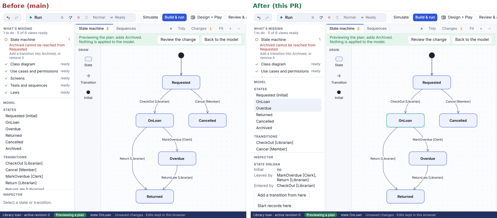
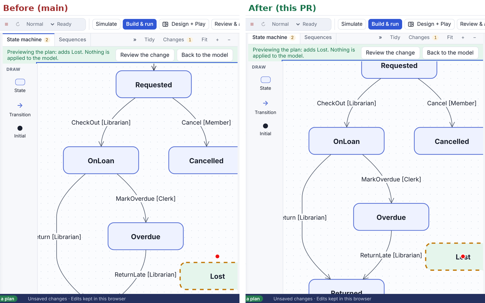
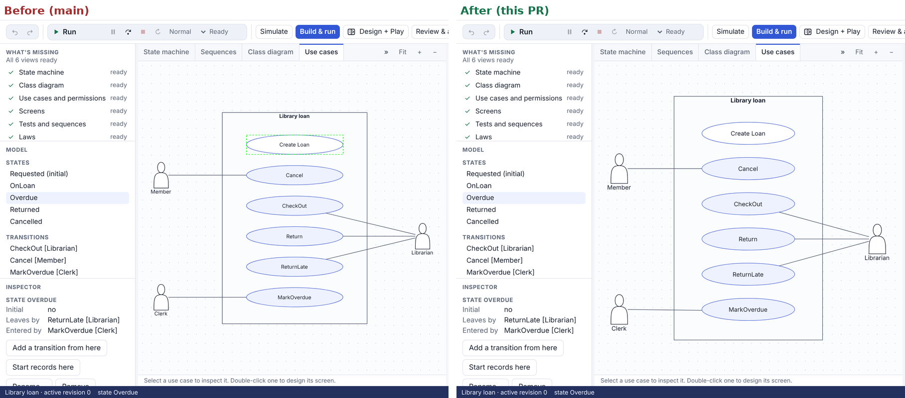
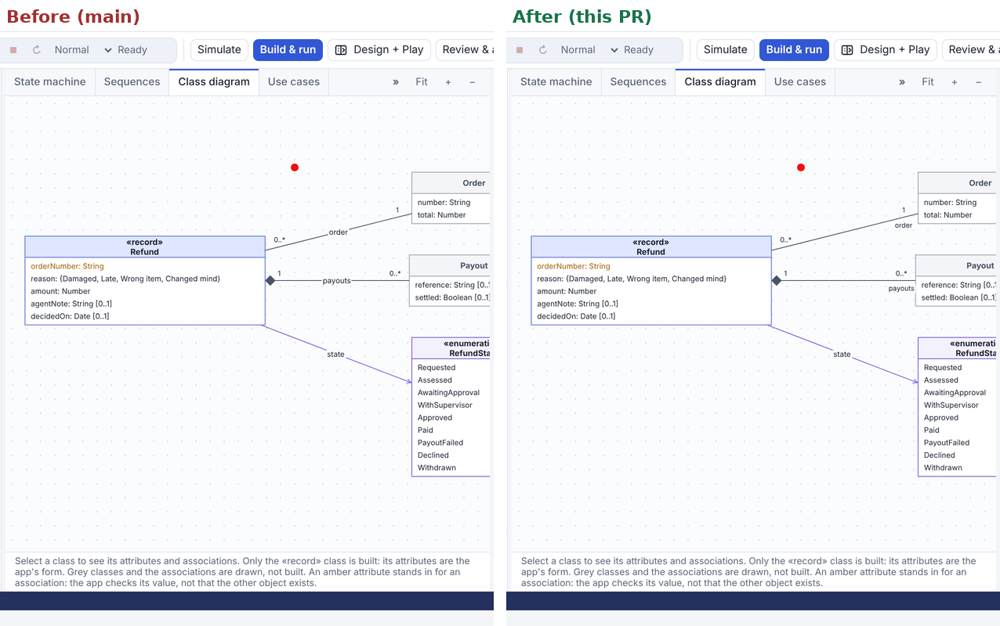
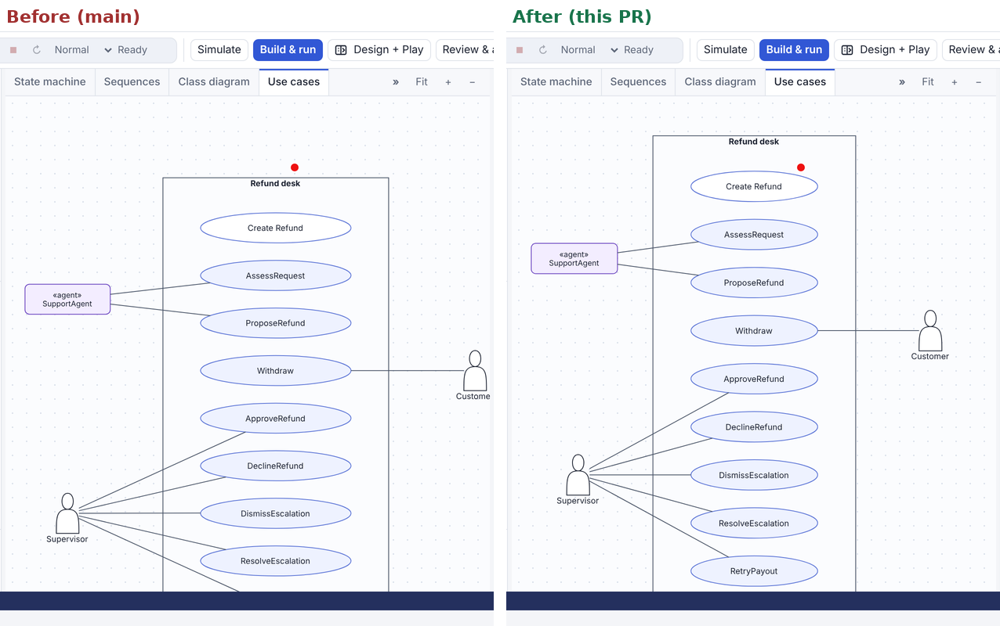
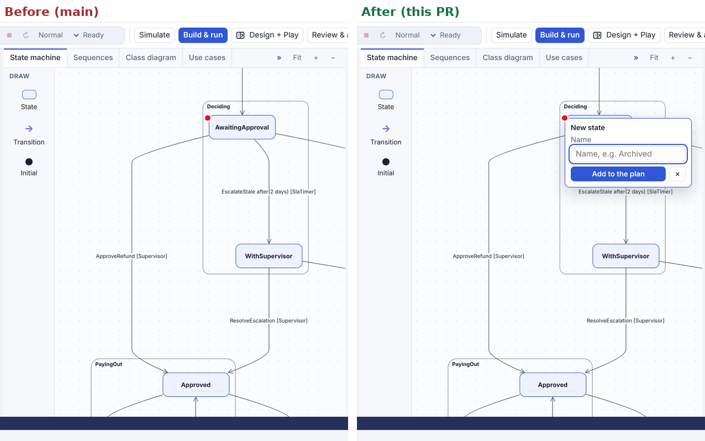

# Fagan inspection: drawing and editing diagrams (13 November 2026)

Scope: the PlayIDE front end that draws and edits diagrams. That covers the canvas, the palette and placement, the inline
editor, rename, transitions, the Delete key and selection, and every diagram kind: state machine (with composite
states), class, use case, sequence, components, system landscape and deployment. The audience knows UML, so notation
was inspected as strictly as behaviour.

Files read line by line: `src/eija_studio/resources/web/play.js` (drawing, editing, selection, layout, the class,
use case and component diagrams), `play-sequence.js`, `play-landscape.js` and `play-deployment.js` (notation).

## Checklist

1. State handling: does every view agree on what is selected, drawn and previewed after any redraw?
2. Event ordering: do observers, redraws and async checks run in an order that keeps the screen still?
3. Stale renders: can a handle, label or inspector outlive what it describes?
4. Selection and focus: do keys act only on what the screen shows? Does focus move the page?
5. Keyboard and mouse paths: click, double-click, drag, drop, Enter, Escape, Delete, F9.
6. Layout at 1280 × 800 with the side bar and the chat open.
7. UML notation: shapes, arrowheads, ends, keywords and label placement.

## Defects

Every defect below was confirmed in Chromium at 1280 × 800 before it was fixed. Each fix has a browser test that fails
on main: `tests/test_play_diagram_inspection.py`, plus the two placement tests of #225.

| # | Severity | Where | Defect | Fix |
|---|---|---|---|---|
| D1 | Major | `play.js` `redrawAll` | Any redraw (a plan step, a preview, Tidy) cleared the inspector but kept `selected`. Delete then added a removal of a state nothing showed as selected, F9 toggled a breakpoint on it, and the status bar still named it. | A redraw selects again what is still drawn (diagram, inspector, outline, status bar) and drops what is gone (`reselect`). |
| D2 | Major | `play.js` `holdStill`, `startDrawing` (#225) | When the first change landed, the plan banner pushed the canvas down 52 px without resizing it, so the `ResizeObserver` never fired and the new state ended up below the pointer. The two placement tests had been red on main. | A `MutationObserver` on the banner's `hidden` holds the drawing still too. |
| D3 | Major | `play.js` `redrawAll`, `inlineEdit` (#225) | A redraw let the panel around the canvas scroll back to the top, and focusing an inline editor below the panel's foot scrolled it. Either one moved the whole diagram by 6 to 25 px. | The panel keeps its scroll through a redraw, and the editor stays in the part of the canvas on screen and is focused with `preventScroll`. |
| D4 | Minor | `play.js` `select` | Choosing in the outline let go of the class diagram's selection only. The use case diagram kept a stale handle next to an inspector about something else. | Every other diagram lets go. |
| D5 | Minor (notation) | `play.js` `drawClasses` | The target end's role name (`data.py`: "the target end's role name") was drawn in the middle of the association, which is where UML puts the association's own name. | It sits at the target end, under the multiplicity (`role-end:<i>`). |
| D6 | Minor (layout) | `play.js` `drawUseCases` | At 1280 px the use case diagram ran 24 to 36 px past the canvas at the readable scale, which cut off the right-hand actor's name ("Custome"). | The boundary and the actors sit closer together. The whole width now fits for every pack. |
| D7 | Minor | `play.js` `tooltip` | Hovering over a composite state's box showed "Initial state". | "Composite state ‹name›". |
| D8 | Minor | `play.js` `onCanvasDoubleClick` | Double-clicking the empty inside of a composite state did nothing, where empty space anywhere else opens a new state editor. | The inside of a composite counts as empty space. |

Ruled out after checking in the browser:

- Delete in the review view (`?view=review`): `play-assist.js` already stops the key there.
- Notation checked and found right: composition and aggregation diamonds at the whole end, filled for composition; sync
  calls with filled heads, dashed replies with open heads, lost messages ending in a dot, and `neg` frames with pentagon
  tabs on the sequence diagram; three-dimensional `«device»` and `«executionEnvironment»` nodes, `«artifact»`s, and
  undirected communication paths on the deployment diagram; lollipop interfaces with dashed `«use»` dependencies on the
  component and system diagrams.

Left as designed: a class diagram wider than the canvas at the readable scale pans rather than shrinking below 0.8
(#139).

## Before and after

Captured from the running app at 1280 × 800: main on the left, this change on the right.

D1, the selection after a redraw. Main shows no selection, yet Delete still removes OnLoan. After the fix, OnLoan stays
selected and the inspector says so.

D2 and D3, placing a state while zoomed in and panned. The red dot is where the click landed.

D4, the use case diagram after choosing a state in the outline.

D5, the role names at the target ends.

D6, the use case diagram at 1280 px.

D8, double-clicking inside a composite state.

