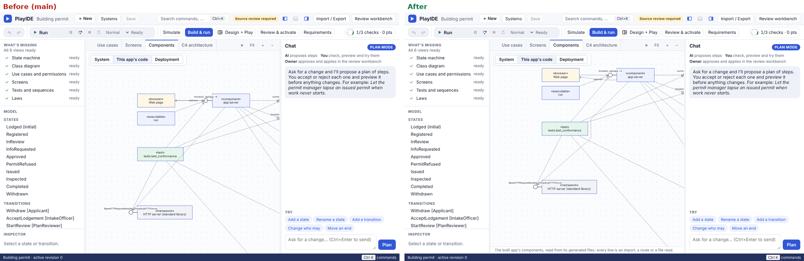
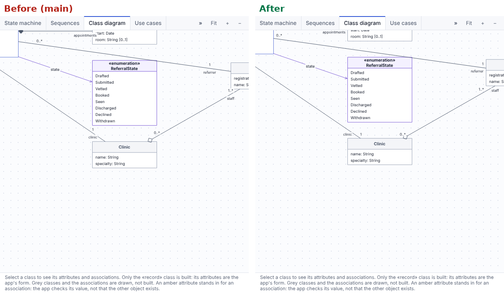
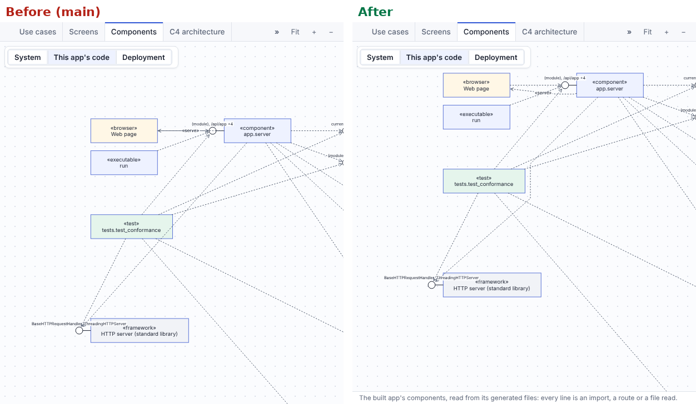
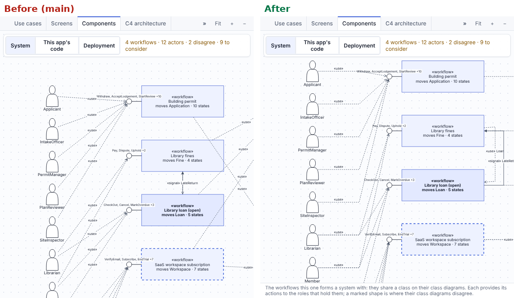
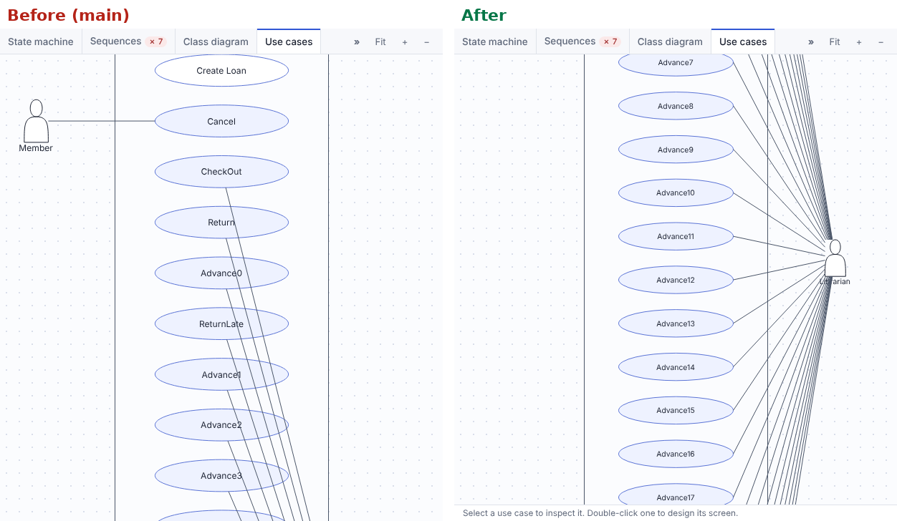
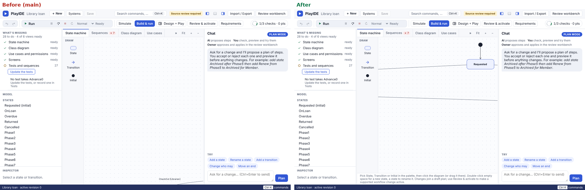

# Second inspection: drawing and editing diagrams (14 November 2026)

This is a deeper pass over the same scope as the [first inspection](../inspection-2026-11-13/README.md): the PlayIDE canvas
and every diagram kind, read as a principal engineer would review it. It adds four things the first pass did not cover:

- a sweep of all ten packs, every tab and every Components lens, that measures in the running app where a line
  crosses a shape it does not connect, a label sits on a shape, or two labels sit on each other;
- a model at the kernel's limits, 32 states and 64 transitions;
- zoom, pan, window resize and side regions opening and closing;
- the keyboard and the screen reader's description of each canvas.

Files changed: `play.js`, `play-landscape.js`, `play-shell.js`, `play-shell.css` and `play.html`.

## Defects

Every defect below was confirmed in Chromium at 1280 × 800 before it was fixed. Each fix is covered by a browser test
in `tests/test_play_diagram_inspection_2.py` that fails on main.

| # | Severity | Where | Defect | Fix |
|---|---|---|---|---|
| E1 | Major | `play-shell.css` (stage grid) | Each diagram canvas took the height of its drawing, not the stage's. maxGraph sizes its SVG to the whole graph, and the workbench's `min-content` row let that through. The Components tab was 1,163 px tall on every pack, and building-permit's state machine was 872 px tall. The workbench scrolled, so the help line and the foot of the diagram went off screen and Fit fitted a canvas taller than the window. At the kernel's limits the state machine canvas reached 3,669 px. | A canvas is `contain: size`, so it takes the stage's height and pans inside it. On narrow screens, where the page scrolls, a diagram gets 420 px of its own. A canvas that now gets shorter (the plan banner arriving) is fitted again when the diagram no longer fits. On main the banner pushed the foot of the state machine 50 px below the window, and the canvas test measured only the canvas, so it passed. |
| E2 | Major (notation) | `play.js` `drawComponents` | On "This app's code", dependency lines ran straight through `app.service`, the server's interface and `tests.test_conformance`. | `detour` sends a line above, below or beside any shape it would cross. |
| E3 | Major (notation) | `play-landscape.js` `render` | On the System lens, actors' lines ran through the actors below them, and links between workflows ran through the workflows in between. Two links in opposite directions ("«use» Loan" and "«signal» LateReturn") lay on top of each other and hid each other's label. | Each actor's line leaves level to a channel, then turns to its interface. Each workflow link runs in its own lane to the right. The classes move right to make room for the lanes. The «use» label sits on the actor's own stretch of line, once per actor. |
| E4 | Major (layout) | `play.js` `drawUseCases` | When an actor has more than a few use cases, its lines ran to their centres and crossed every use case in between. A model at the limits had dozens of such crossings. | Each line ends at the tip of its use case on the actor's side. The tips line up in one column, so a line passes outside the others. |
| E5 | Minor (notation) | `play.js` `drawClasses` | Multiplicities and role names sat at a fixed 80 % of the line. When a line was short or steep, they landed on the class box: specialist-referral's `clinic` overlapped Clinic, and two multiplicities overlapped Referral and Clinician. The role name was a regression from D5 of the first pass. | Each label starts at its end of the line and moves back along it until it is clear of its class. Multiplicities sit on one side of the line and the role name on the other. |
| E6 | Minor | `play.js` `showTab`, `fit`, resize | Coming back to a tab, resizing the window, or opening or closing a side region fitted the diagram again. This threw away the zoom and pan the person had chosen. | `refit` fits again only when nobody has moved the view since the last fit. The Fit button still fits. |
| E7 | Minor (keyboard) | `play.js` | Escape did not let go of a selection on any diagram. | Escape clears the selection of the diagram that has focus, once an armed tool or an inline editor has had the key. |
| E8 | Minor | `play.js` `fit` | A state machine too large for the canvas at the readable scale opened at the top left of its drawing. The initial state was 1,100 px to the right of the screen. | Fit then pans, only as far as needed, to bring the initial state and its first state into view. |
| E9 | Minor (accessibility) | `play.html` | Only the state machine canvas was described by the help line under the diagram. The class, use case, Components, System and Deployment canvases had no description. | Every canvas has `aria-describedby="canvas-help"`. |

Ruled out after checking in the browser:

- On the sequence diagram, an activation bar overlaps the invariant drawn on the same lifeline. That is the UML
  notation for a state invariant on an activation, so it was left as it is.
- The diagram tabs already follow the WAI-ARIA tabs pattern (`play-shell.js` `tabKeys`).
- A model at the limits loads in about a second, and no tab raised an error.

Left open: on the System lens, actors' lines still pass over an interface's list of actions as they converge on its
ball. Moving that list would change the lollipop notation, so it is a design question, not a fix.

## Before and after

Captured from the running app at 1280 × 800, with main on the left and this change on the right. The large model is
library-loan stretched to 32 states and 64 transitions, the same model the tests build.

E1: the Components tab on building-permit. On main the canvas runs past the window and the help line is gone.

E5: specialist-referral's class diagram around Clinic.

E2: library-loan's components.

E3: the System lens.

E4: the use cases of the model at the limits.

E8 and E1: the same model opening on its state machine.

