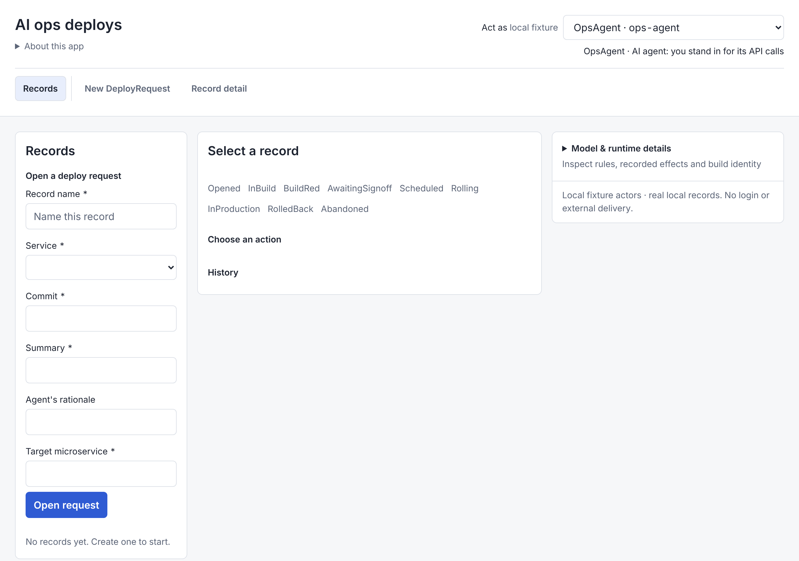
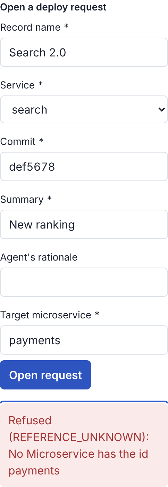
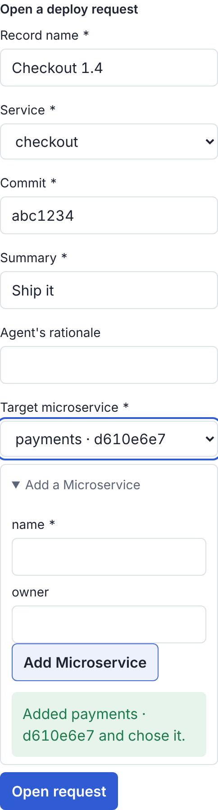
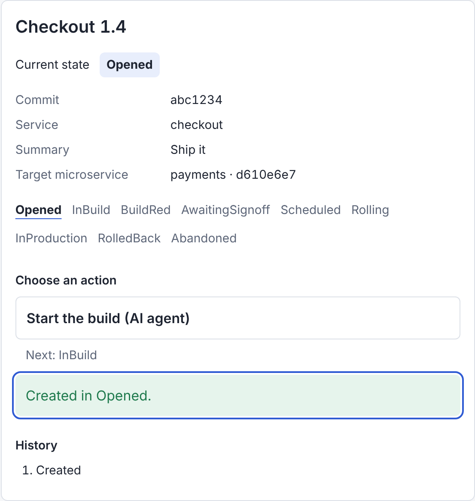
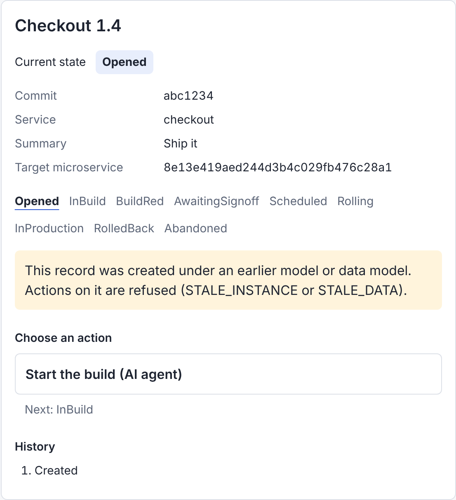
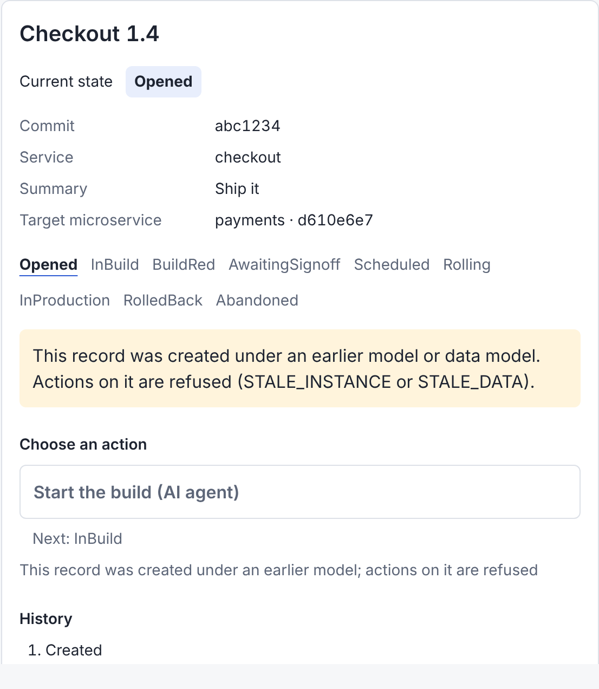

# Inspection of the app generator, 13 November 2026

A Fagan-style inspection of the code that turns a model into a runnable app: `application/appgen.py`, `application/app_runs.py`, `application/oracle_session.py`, `application/generated_app.py`, `interfaces/app_build.py`, `adapters/generated_apps.py` and the templates in `resources/appgen/` (service, server, conformance tests and the React page). Each file was read line by line against ADR-0150, ADR-0207, ADR-0224, ADR-0225, ADR-0231 to ADR-0243 and this checklist:

1. A model feature the generator ignores or mistranslates.
2. Escaping, naming and type handling at the HTTP boundary.
3. A generated test that cannot fail (checked by seeding the fault and running the generated suite, as `verification.conformance.divergence` does).
4. Stale output: what the app shows that it will not do.
5. Error paths and concurrency.

Issue #249 (from the command line and server inspection) was folded in. Decision record: [ADR-0249](../adr/0249-app-generator-inspection-fixes.md).

## Defects

| # | Severity | Where | Defect | Fix and regression test |
|---|---|---|---|---|
| G1 | Major | `react-source/main.jsx` `Field` | A record field that refers to another object (a built association, ADR-0235) was a bare text box asking for a 32-character id, and the page had no way to make the object. In ai-ops (DeployRequest needs a Microservice) no record could be created from the page. | The field is a list of the stored objects by name, with an "Add a Microservice" form beside it that creates one and chooses it. Values show the object's name, not its id. `test_a_person_adds_the_object_and_creates_the_record_in_a_real_browser` |
| G2 | Major | `test_conformance.py.tmpl` | No generated test called `Service.create_object` or `POST /api/objects/{class}`; `stock()` writes objects straight into the table. An app that skipped the data model's check on an object, or started it outside its lifecycle's initial state (ADR-0241), passed. | New oracle list `object_cases` (valid object, each value missing, wrong type, too long, not a choice, an unknown field) and test `test_objects_a_record_refers_to_are_stored_as_the_data_model_says`, also over HTTP. |
| G3 | Major | `test_conformance.py.tmpl` | No generated test checked that a committed step restarts the record's clock. An app that kept the old entry time would make a time event due at once in the next state (ADR-0237). | `test_a_step_restarts_the_records_clock`, with the app's clock fixed. |
| G4 | Major | `service.py.tmpl` reads | `records`, `view`, `outbox` and `objects` read the shared SQLite connection outside the write lock, so a read during a write saw rows the write later rolled back. | Reads take the lock. `test_a_read_never_sees_a_write_that_rolls_back` |
| G5 | Minor | `test_conformance.py.tmpl` | `POST /api/signals` (ADR-0242) was never called over HTTP. An app whose route dropped the signal's values, or delivered every signal under one operation id, passed. | Signal cases now also run over HTTP, and the oracle holds the stored values and the kernel's answer for the same signal sent again under a new operation id. |
| G6 | Minor | `service.py.tmpl` `view` | A record of an earlier model or data model offered its actions as allowed, and taking one was refused (`STALE_INSTANCE`, `STALE_DATA`). | Every option on such a record is not allowed, with the code `act` will give. Extended `test_records_from_another_data_model_are_refused`; `test_a_stale_record_offers_no_action_it_will_refuse` |
| G7 | Minor | `server.py.tmpl` (issue #249) | No `Host` check: a page using DNS rebinding could read and write a running app on loopback. | `HOST_DENIED` (403) unless `Host` is `127.0.0.1:<port>` or `localhost:<port>`, as PlayIDE's own server does. Generated test `test_only_requests_to_the_apps_own_address_are_answered`. |
| G8 | Minor | `server.py.tmpl` `do_POST` | `str(...)` turned any JSON value into text: `{"title": null}` made a record titled `None`, `42` one titled `42`. | `title`, `actor`, `action`, `signal` and `sender` must be strings (`BAD_REQUEST`). `test_a_value_that_is_not_text_is_refused_not_turned_into_text` |
| G9 | Minor | `server.py.tmpl` | An unforeseen exception dropped the connection with no answer. | Answered `500 INTERNAL_ERROR`. `test_an_unforeseen_failure_is_answered_not_dropped` |
| G10 | Minor | `appgen.py` `readme` | README.md counted only the state × action cases (120 of 420 for library-loan), not the total the build manifest reports. | Same total. `test_the_readme_counts_the_cases_the_build_reports` |

All ten are fixed. The fifteen repository tests in `tests/test_appgen_inspection.py` fail on `main` before the fix and pass after it.

## Seeded faults the generated suite missed

Seeded with the divergence harness's own `judge` (resealed, so only behaviour can catch them):

| Fault | Subject | Before | After |
|---|---|---|---|
| a step does not restart the record's clock | refund-desk | MISSED | CAUGHT |
| created objects skip their lifecycle's start | ai-ops | MISSED | CAUGHT |
| created objects' values not checked | ai-ops | MISSED | CAUGHT |
| HTTP signal drops its values | library-fines | MISSED | CAUGHT |
| HTTP signals share one operation id | library-fines | MISSED | CAUGHT |
| stale records offer their actions | every pack | (defect G6) | CAUGHT |
| the app answers any host | every pack | (defect G7) | CAUGHT |

All seven are now in `verification/conformance/divergence.py` `CODE`. The generated suite runs 20 tests, up from 17.

## Before and after

G1, ai-ops, before: the target is a text box, and the only way to fill it is an id the page never shows.




After: choose a stored Microservice or add one in place; the record shows its name.




G6, a record of an earlier model. Before, "Start the build" is enabled under the warning; after, it is disabled with the reason.




G7 and G8 over HTTP, on a running ai-ops app:

```text
before  GET /api/app  Host: rebound.example:8811   -> 200 {"name": "AI ops deploys", ...}
after   GET /api/app  Host: rebound.example:8812   -> 403 {"code": "HOST_DENIED", "message": "Loopback host required"}
before  POST /api/records {"title": null, ...}     -> 201, stored title 'None'
after   POST /api/records {"title": null, ...}     -> 400 {"code": "BAD_REQUEST", "message": "title must be a string"}
```

## Checked and not defects

- Model text reaches the generated Python only as JSON files, never as code, so a name cannot inject code. React escapes every value it shows.
- `NaN` and `Infinity` in a number field are refused by the data model (`FIELD_TYPE`).
- Deeply nested JSON is bounded by the 16 KB body limit.
- One action from several states always shares its target (ADR-0232), so the rule table's single "To" is right.
- A stale record's refusal does not depend on the actor: `act` checks the data digest, then the kernel checks the model hash, before anything about the actor.
