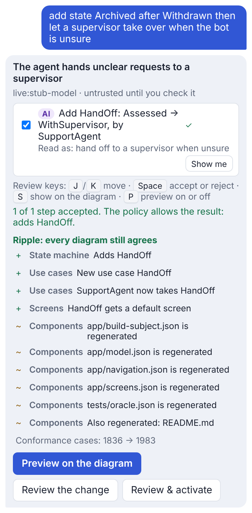
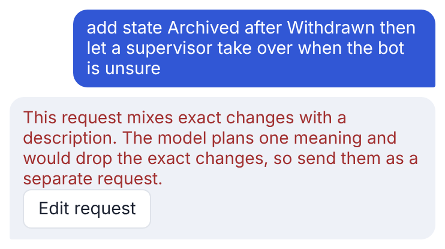
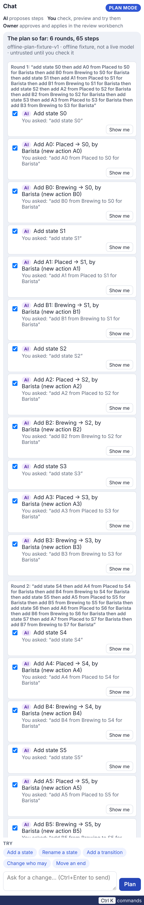
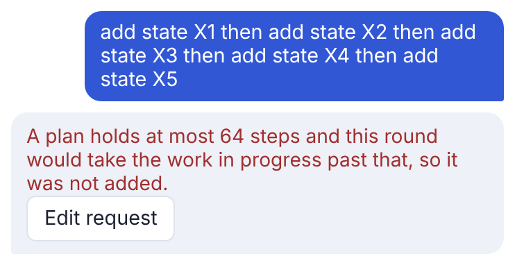
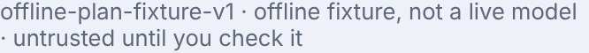
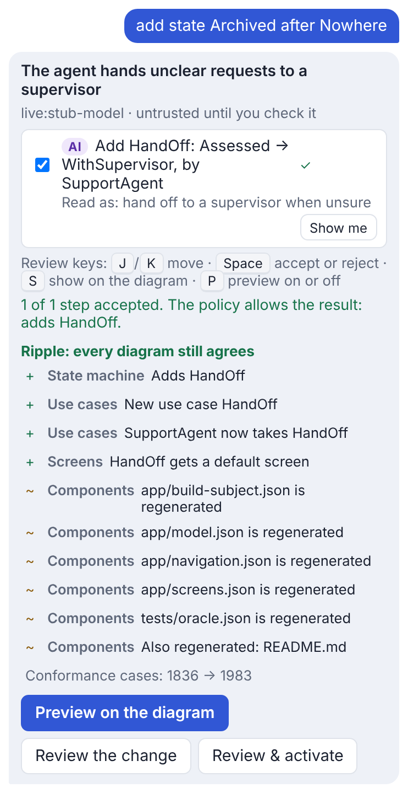
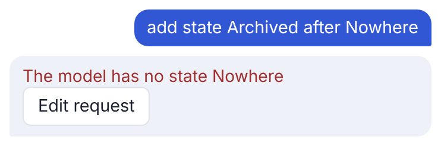

# Fagan inspection: AI chat, plan mode and the proposer (2026-11-13)

* Scope: the PlayIDE chat in plan mode (ADR-0156, ADR-0201), the offline and opt-in live plan proposers (ADR-0230),
  the OpenAI provider and the shared provider plumbing (ADR-0229), `plan_check` for agents, plan preview, accept and
  reject, owner selection of a plan (`/api/cases/from-plan`), "Describe your app" and "Update the tests" (ADR-0216),
  and the read-only review view (ADR-0172).
* Material read line by line: `adapters/live_plan_proposals.py`, `adapters/plan_proposals.py`,
  `adapters/providers/{_common,_http,openai_api,registry}.py`, `application/plan.py`, `application/owner_plan.py`,
  `application/describe_system.py`, `application/service_views.py` (`plan_check`), `interfaces/play.py` (plan routes),
  `interfaces/mcp_server.py` (`plan_check`), and the chat half of `resources/web/play.js`.
* Method: Fagan-style. Each item of the checklist below was traced through the code, each suspected defect was
  reproduced with a script or a test before it was logged, and each fixed defect has a regression test that fails on
  the code before the fix.

## Checklist

| Item | Result |
| --- | --- |
| A plan applied without passing checks | Pass. `from_plan` re-applies the exact steps through the policy and refuses `CANDIDATE_CHANGED` unless the reviewed candidate hash is reproduced. |
| Partial apply | Pass. The accepted steps are applied as one change (`apply_transactions`); a step that does not apply blocks the whole preview. |
| Reject not restoring state | Pass. Preview is never persisted; leaving it redraws the model in force; unticking re-runs the server preview. |
| Provider errors and timeouts | Pass. One bounded attempt, no redirect, capped body; failures map to stable codes without the response body. |
| Key handling and leakage | Pass. Keys come from the environment or memory, travel only in a header, are never stored or echoed; `store: false`. |
| Live mode switching on without opt-in | Pass. Live needs a networked provider, `--allow-network` and a strict boolean `consent`; the box unticks after each send. |
| Preview differing from what was asked | **Fail**, defect 1. |
| One provider call at a time | **Fail**, defect 2. |
| Plan size bounds hold across rounds | **Fail**, defect 3. |
| Provenance shown is true for every step | **Fail**, defect 4. |
| Review view cannot change the model | Pass. The chat is closed and its commands are filtered out in `?view=review`. |

## Defects

Severity: Major (a wrong result a person may act on), Minor (wrong, but visible or recoverable), Trivial. Eight of nine are fixed; one was withdrawn on re-inspection.

| # | Severity | Where | Defect | Status |
| --- | --- | --- | --- | --- |
| 1 | Major | `adapters/live_plan_proposals.py`, `propose` | A live request that mixes exact phrases with prose ("add state Archived after Approved then let a supervisor take over...") was sent whole to the model, which plans one meaning, so the exact clause was silently dropped from the plan. The offline reader is careful never to drop a clause it read. | Fixed: refused before anything is sent, `PLAN_REQUEST_MIXED`. |
| 2 | Minor | `adapters/live_plan_proposals.py` | The chat's live path had no single-flight guard, unlike `Studio.propose` (`PROVIDER_BUSY`), so two tabs or a double send could make two billed calls. | Fixed: one live call at a time; a second is refused and never sent. |
| 3 | Minor | `interfaces/play.py` `play_plan`; `resources/web/play.js` `addRound`, `addStep` | Rounds on a system you started stack without a bound. A round that takes the plan past `MAX_DRAFT_STEPS` (64) was planned and added, and every preview after it failed validation, leaving a plan that can no longer be checked. | Fixed: the server refuses `PLAN_TOO_LONG`; the page also counts rejected steps, which the server cannot see. |
| 4 | Minor | `resources/web/play.js` `addRound`, `planCard` | The plan card's provenance line took the latest round's provider for the whole plan, so steps a live model wrote were labelled "offline fixture, not a live model" after an offline round, and the reverse. | Fixed: each AI step keeps its provider; the card names every one and says when the plan is mixed. |
| 5 | Minor | `adapters/live_plan_proposals.py` | A request shaped like an exact phrase but with a wrong name ("add state Archived after Nowhere") fell through to the live provider (with consent) and came back as an unrelated meaning instead of the phrase reader's "no state Nowhere". | Fixed: the phrase reader's `PLAN_UNKNOWN_NAME` answer is returned and nothing is sent. Owner's call (2026-11-13, "fix all"): a paraphrase that happens to match a phrase shape ("let supervisors approve") now gets the phrase reader's answer, which names the real roles, instead of going to the model. |
| 6 | Minor | `adapters/live_plan_proposals.py`, `bootstrap.py` | A live chat call left no audit event. `Studio.propose` records `ProviderCallStarted` and `ProviderCallNotAccepted` (request hash, billing UNKNOWN); the chat's live calls were invisible in the audit log. | Fixed: `PlanProviderCallStarted`, then `PlanProposalReceived` or `PlanProviderCallNotAccepted`, with a request hash, never the request. |
| 7 | Minor | `application/service_views.py` `plan_check`; `interfaces/cli.py` | `plan_check` always previewed as a shipped pack (`grows=False`), so on a system you started a plan naming a new action or role was refused although the chat accepts it. | Fixed: `eija mcp` on a system in the systems home (`--systems`, default `~/PlayIDE`) checks as the chat does, and the result says `grows`. |
| 8 | — | `application/describe_system.py` `update_tests` | Logged as "a failing refusal test is dropped, not recorded again". | Withdrawn on re-inspection. A refusal test fails only when the kernel now allows that step, so recording it again would write an accepted step under a "cannot" title. Dropping it, reporting "removed", and adding the new refusal as "added" is right. |
| 9 | Trivial | `application/describe_system.py` `_slug` | Two end states whose names differ only in underscores (`Paid_Out`, `Paid__Out`) slugged to the same test id, so the description was refused. | Fixed: later ones get `-2`, `-3`. |

## Before and after

Screenshots come from the real chat in Chromium. "Before" is `main` at 22298bc2, and "after" is this branch. Both are the same
Playwright script against an in-process server whose live provider is a stub that counts its calls.

| # | Before | After |
| --- | --- | --- |
| 1 |  The exact clause "add state Archived" is gone from the plan; 1 provider call. |  Refused in words; 0 provider calls. |
| 3 |   Round 6 is added (65 steps) and the plan can no longer be checked: `CONTRACT_REJECTED`. |  The round is refused; the 60-step plan stays checked. |
| 4 |  After an offline round, the live round's steps read "offline fixture, not a live model". |  Both sources named, and the plan says it is mixed. |
| 5 |  "add state Archived after Nowhere" is sent and comes back as the HandOff meaning; 2 provider calls in total. |  The phrase reader says there is no state Nowhere; still 0 provider calls. |

Defect 4 cannot be reached with a real provider today, because a system you started models no meanings for a model to
pick. The first round's reply is therefore the real offline reply relabelled as a live model's (`page.route`), the
way a live provider labels it. The second round is untouched.

Defects 2, 6, 7 and 9 have no screen. Their evidence is the regression test failing on `main` and passing here:

```text
main (22298bc2):
FAILED tests/test_live_plan.py::test_a_second_live_request_while_one_runs_is_refused_and_never_sent
FAILED tests/test_live_plan.py::test_every_live_call_is_audited_by_a_hash_never_the_request
    AssertionError: assert [] == ['PlanProviderCallStarted', 'PlanProposalReceived']
FAILED tests/test_live_plan.py::test_bootstrap_wires_the_live_proposer_to_the_studio_audit_log
    AttributeError: 'LivePlanProposer' object has no attribute 'audit'
FAILED tests/test_live_plan.py::test_plan_check_on_a_system_you_started_declares_new_names_as_the_chat_does
    KeyError: 'grows'   (and legal stays False on a system you started)
FAILED tests/test_play_describe.py::test_two_end_states_whose_test_titles_slug_alike_get_distinct_test_ids
    assert 2 == 1  where ids = ['payment-reaches-paid-out', 'payment-reaches-paid-out']
this branch: all pass
```

## Regression tests

* `tests/test_live_plan.py::test_a_request_that_is_partly_exact_phrases_is_refused_before_anything_is_sent` (1)
* `tests/test_live_plan.py::test_a_second_live_request_while_one_runs_is_refused_and_never_sent` (2)
* `tests/test_play_greenfield.py::test_a_round_that_would_take_the_plan_past_one_preview_is_refused` (3)
* `tests/test_live_plan.py::test_an_exact_phrase_naming_what_the_model_lacks_gets_the_phrase_readers_answer_and_is_not_sent` (5)
* `tests/test_live_plan.py::test_every_live_call_is_audited_by_a_hash_never_the_request` and `test_bootstrap_wires_the_live_proposer_to_the_studio_audit_log` (6)
* `tests/test_live_plan.py::test_plan_check_on_a_system_you_started_declares_new_names_as_the_chat_does` (7)
* `tests/test_play_describe.py::test_two_end_states_whose_test_titles_slug_alike_get_distinct_test_ids` (9)

Each fails on `main` before the fix and passes after. Defect 4 was checked in Chromium (the card's provenance line)
and by the chat browser tests in `test_play_diff.py`, `test_play_history.py` and `test_play_game.py`.
