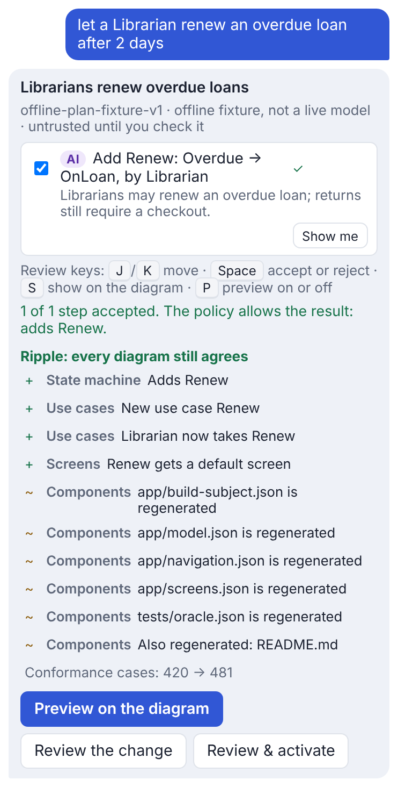
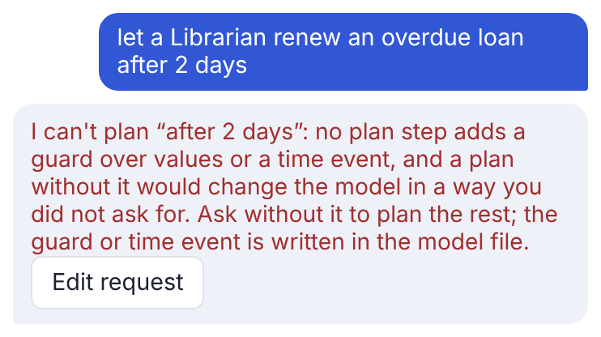
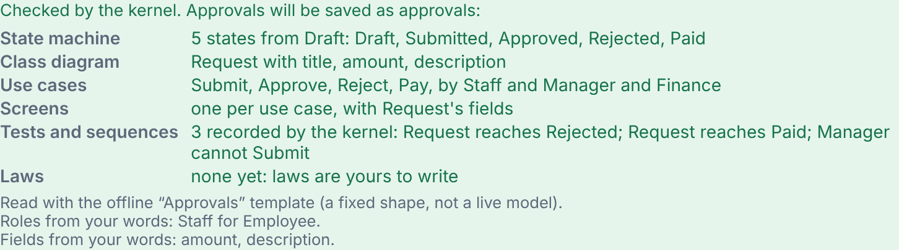
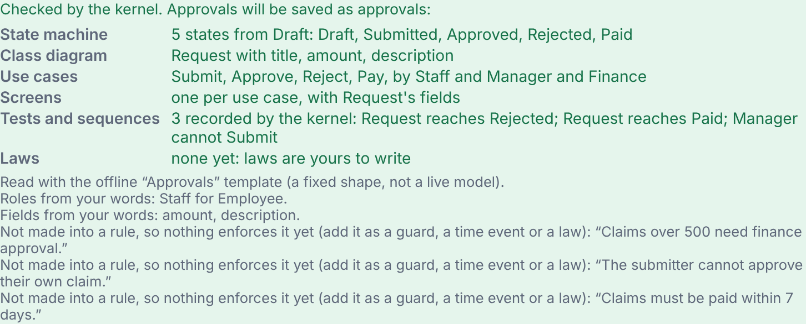
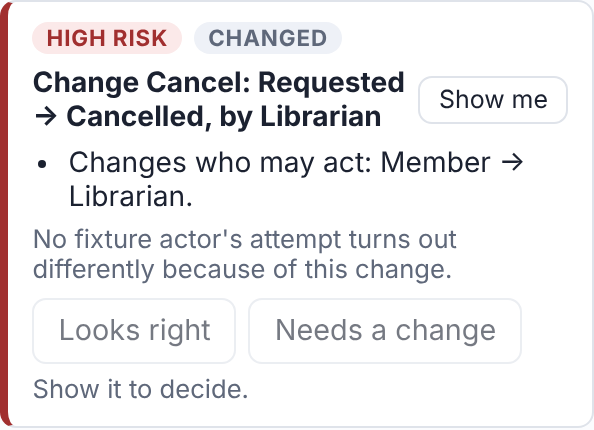
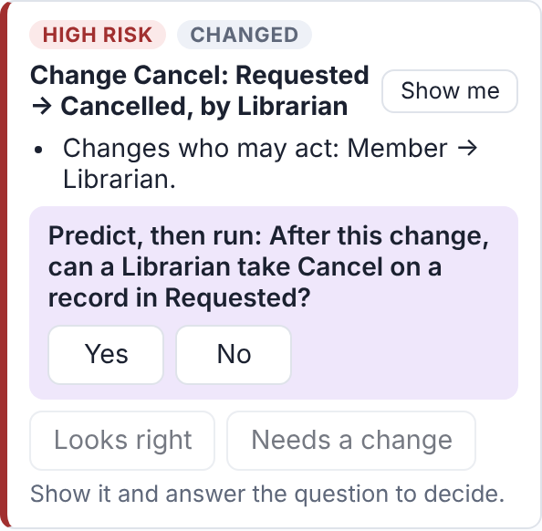

# Fagan inspection, second pass: AI chat, start flow and review view (2026-11-14)

* Scope: a deeper pass over the slice of the [first inspection](2026-11-13-ai-chat-plan-mode.md), aimed at what it
  did not reach: the start flow ("Describe your app", ADR-0216), the review view and its behaviour diff (ADR-0175),
  and whether plans, `plan_check` and the review know the kernel features merged since (value guards ADR-0234, time
  events ADR-0237, linked steps ADR-0241, `UNDECLARED_ROLE` from #258, `LINKED_LIFECYCLE_CONFLICT` from #257).
* Material read line by line: `application/review.py`, `application/access.py` (`meeting`, `reach`),
  `application/diagrams.py` (`diff_summary`), `adapters/system_describer.py`, `application/describe_system.py`,
  `adapters/plan_proposals.py`, `adapters/live_plan_proposals.py`, `quality/evals/intent.py`, and
  `resources/web/play-review.js`, `play-systems.js`.
* Method: as before. Each suspected defect was reproduced with a script before it was logged, and each fix has a
  regression test that fails on `main` (41369a25) and passes on this branch.

## Checklist

| Item | Result |
| --- | --- |
| Plans know today's kernel codes | Pass. A plan step naming an undeclared role is refused `UNDECLARED_ROLE` in the preview and in `plan_check`; on a system you started, rounds declare the role first. |
| A plan carries everything the request asked for | **Fail**, P1. |
| The start flow says what it did not read | **Fail**, S1. |
| The review shows every changed behaviour | **Fail**, R1. |
| The review handles every field a transition has | **Fail**, R2. |
| A selected plan is the reviewed one | Pass. `from_plan` re-applies the steps and checks the candidate hash. |
| Undo keeps per-step provenance | Pass. |
| Describe output builds and passes conformance with awkward field names (`id`, `state`, `version`, `class`) | Pass. |
| Intent eval grades by the kernel, not a model | Pass. `kernel_allows` runs the product path; a disagreement is listed separately from the provider's score. |

## Defects

Severity: Major (a wrong result a person may act on), Minor (wrong, but visible or recoverable). All four are fixed.

| # | Severity | Where | Defect | Status |
| --- | --- | --- | --- | --- |
| P1 | Major | `adapters/plan_proposals.py` `propose`; `adapters/live_plan_proposals.py` | A request with a limit on a value or a time ("let a Librarian renew an overdue loan after 2 days", "only when renewals under 3") was planned without the limit: an unguarded Renew, checked green, "The policy allows the result". No plan step can add a guard over values or a time event, so this is the #152 substitution: a green plan for a change nobody asked for. The live path sent it to the model, which can't express the limit either. | Fixed: refused with `PLAN_LIMIT_UNSUPPORTED`, naming the limit, and never sent to a live model. |
| S1 | Major | `adapters/system_describer.py` `describe` | The offline reader makes no guard, time event or law from words, but the summary listed only what it read. "Claims over 500 need finance approval", "The submitter cannot approve their own claim" and "within 7 days" vanished, and the person was left to believe the new system enforces them. | Fixed: each rule sentence, up to six, is said back as "Not made into a rule, so nothing enforces it yet". |
| R1 | Major | `application/review.py` `_attempt`, `behaviour_diff` | Each attempt started on a record with no values that had just entered its state. A step behind a guard over values was refused `VALUE_GUARD_DENIED` on both sides, and a timed step `TIMER_NOT_DUE`, so a change of who may take it showed "No fixture actor's attempt turns out differently because of this change": a high-risk role change with no question and a false all-clear. | Fixed: both attempts hold values meeting the action's guards in either model (the `meeting` witness the permissions view already uses) and wait out every time event. Rows say which values they held. |
| R2 | Minor | `application/review.py` `_field_reasons`; `application/diagrams.py` `_shown` | A change to a transition's guards over values or linked steps raised `KeyError` in the review, and a time event read as "Renames its id". `diff_summary` sorted guard objects, so two guards on one changed transition raised `TypeError` in the plan preview, the review and the case diagrams, and the case summary table could not join one. | Fixed: each field has its own reason and risk, and changed values are their UML text (`renewals ≤ 3`, `after(14 days)`, `target.lock`). |

## Before and after

Screenshots come from the real page in Chromium. "Before" is `main` at 41369a25, from a `git worktree`. "After" is this
branch. Both runs used the same Playwright script against an in-process server, with the offline proposer.

| # | Before | After |
| --- | --- | --- |
| P1 |  "after 2 days" is gone: an unguarded Renew, ticked and "The policy allows the result". |  Refused, naming “after 2 days”, with the request kept to edit. |
| S1 |  Three rules in the description, none mentioned. |  Each rule is said back as not enforced. |
| R1 |  Cancel (guarded `renewals ≤ 3`) moved from Member to Librarian: "No fixture actor's attempt turns out differently". |  The kernel's rows and a predict-then-run question. |

R2 has no screen to reach from a plan, because no plan step edits these fields. A change case or an imported model
can. Its evidence is the regression test:

```text
main (41369a25):
FAILED tests/test_review.py::test_a_change_to_value_guards_time_events_or_linked_steps_is_reviewed_not_a_crash
    TypeError: '<' not supported between instances of 'ValueGuard' and 'ValueGuard'
    (with one guard: KeyError: 'conditions' in _field_reasons)
this branch: passes
```

## Regression tests

* `tests/test_plan.py::test_a_limit_on_a_value_or_a_time_is_refused_not_dropped` (P1, four phrasings)
* `tests/test_live_plan.py::test_a_limit_on_a_value_or_a_time_is_refused_before_anything_is_sent` (P1, live)
* `tests/test_play_describe.py::test_a_rule_in_the_description_is_said_back_as_not_enforced` (S1)
* `tests/test_review.py::test_a_role_change_on_a_guarded_step_is_seen_on_a_record_whose_values_meet_the_guard` (R1)
* `tests/test_review.py::test_a_role_change_on_a_timed_step_is_seen_once_its_time_event_is_due` (R1)
* `tests/test_review.py::test_a_change_to_value_guards_time_events_or_linked_steps_is_reviewed_not_a_crash` (R2)

All nine fail on `main` and pass here. The full suite passes (3,705 tests).

## Logged, not fixed

* The behaviour diff still tries one record per action, holding values that meet the guards. When only a guard or a
  time event changes, the attempts agree, so the item has reasons but no kernel rows. Trying a record that fails the
  guard, and one that has not waited, would show who is newly refused. The review's limits say this.
* The rule reader in S1 is a word list: it says a rule back, it does not make one. Making a law from a sentence is a
  live describer's job, and is the owner's call (ADR-0216).
