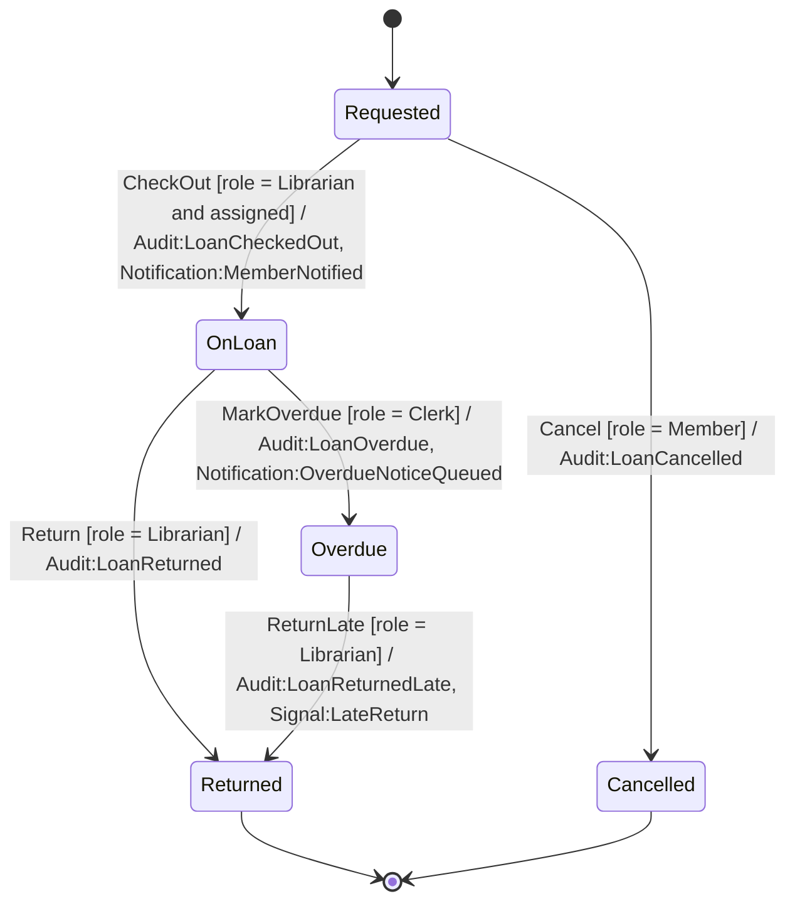
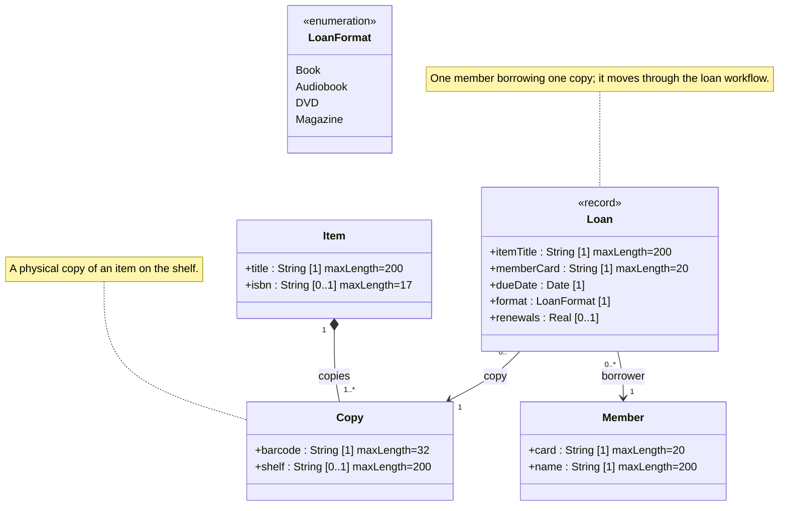

<!-- GENERATED by PlayIDE (eija.uml-interop.v1) from pack library-loan 1.0.0, model 246996f89e9a77d1fa7441141309232dc5827b9f59a9c5ba620fcdda0c615549. -->
# Library loan

## State machine

## Class model

